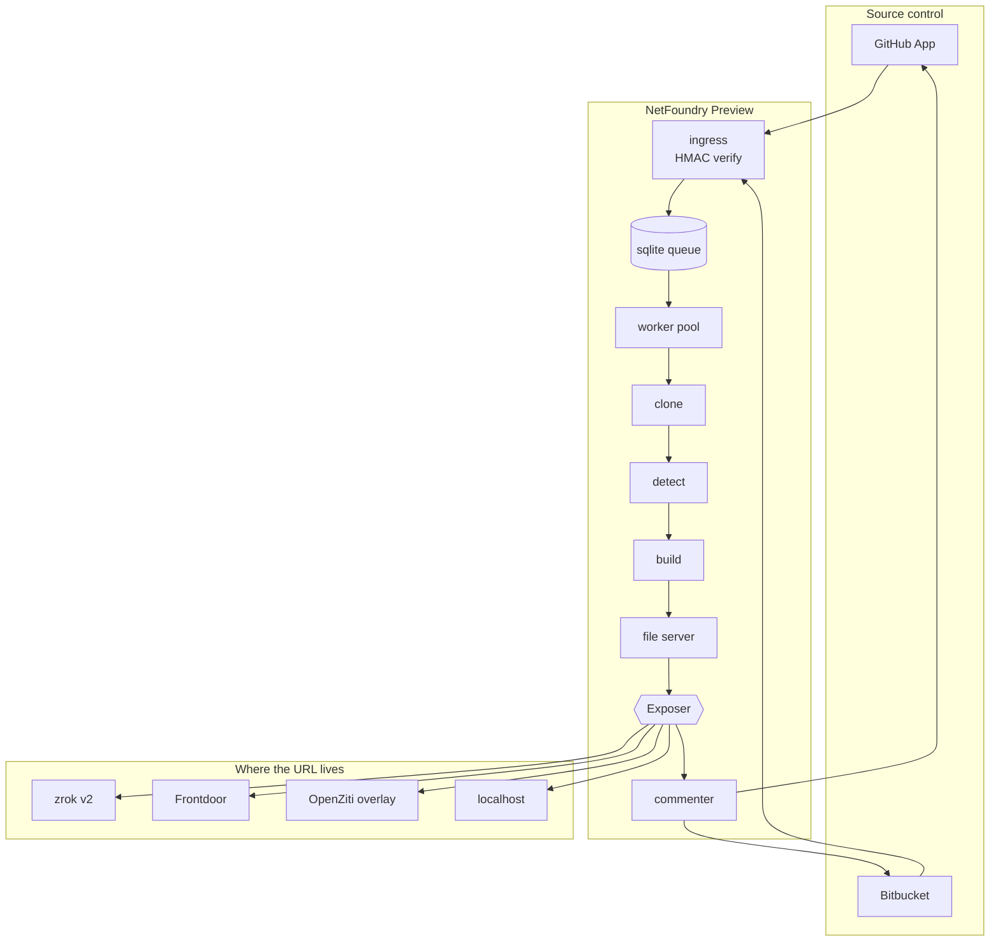

# Architecture

One Go binary, one sqlite file, one directory of build artifacts. Builds run in Docker by default, and Kubernetes is
not involved.



## The two interfaces

Most design decisions here come from keeping two interfaces small and stable.

### `Exposer`

```go
type Exposer interface {
    Kind() string
    Validate(ctx context.Context) error
    Publish(ctx context.Context, spec Spec, h http.Handler) (*Publication, error)
    Reap(ctx context.Context, keep map[string]bool) error
    Close() error
}
```

It takes an **`http.Handler`**, not a port number, and most of the design rests on that.

zrok's Go SDK hands back a listener on the OpenZiti overlay. A preview published through zrok binds no local TCP
port and does not appear in `netstat`. An interface that demanded a port would bend zrok out of shape to suit
Frontdoor. A handler lets each implementation bind what it needs: Frontdoor binds a real port because its agent
connects back over the network, and zrok binds nothing.

Four implementations, selected by one line of config. See [Exposers](./exposers.md).

### `scm.Client`

```go
type Client interface {
    Platform() model.Platform
    VerifyWebhook(ctx, headers, body) ([]Event, error)
    CloneURL(ctx, pr) (string, error)
    ChangedFiles(ctx, pr) ([]string, error)
    Publish(ctx, report) error
    Retract(ctx, pr) error
}
```

GitHub and Bitbucket disagree on nearly every detail and agree on this shape. GitHub uses App-installation JWTs,
Bitbucket an access token. GitHub edits a comment with `PATCH`, Bitbucket with `PUT`. GitHub has check runs,
Bitbucket build statuses.

`ChangedFiles` asks the platform instead of computing the answer from git. Working it out locally means finding the
merge base, which means fetching enough history to have one. Both hosts already know the answer, and asking costs
one request, which keeps the clone at `--depth 1`.

## Identity: two names doing two jobs

**Preview ID**: `sha256(platform|owner|repo|number)[:12]`.

It leaves out the branch and the commit, so a pull request keeps one preview for its whole life, even through a
force-push or a branch rename. This ID is what finds the comment to edit. If it moved, every push would post a fresh
comment. A branch preview has no number, so its branch name goes into the hash too.

**Public name**: the sanitized branch name, by default.

`feature/JIRA-123_new guide` is not a hostname, so it becomes `feature-jira-123-new-guide-a1b2c3`. The hash suffix
appears only when the transformation loses information, so `main` stays `main`. Without it, `feature/foo` and
`feature_foo` would both become `feature-foo`, and two open pull requests would quietly steal each other's URL.

The default template then prefixes the repository, giving `docs-feature-jira-123-new-guide-a1b2c3`, because the
branch alone is not unique across repositories and every exposer keys a live publication on this name. Change it
with `name_template`. See [the reference](reference/configuration.md#name_template) for the common variants.

Each preview gets its own share, name and listener, and each is withdrawn by preview ID, not by name.
`Exposer.Reap` deletes anything carrying the `nfpreview:` target tag that the database no longer claims. It runs
at startup and on every sweep tick after that.

By default a preview has exactly one share, and a rebuild serves the new build on it. With
`exposer.build_shares: true`, each build also gets a share of its own: the branch name with the short commit
appended, keyed on preview ID plus build ID. A reviewer can then open the site as it was at a given commit.
Publishing one is best effort, so a failure leaves the branch URL and the comment alone. `preview.keep_builds`
bounds how many are kept. See [the reference](reference/configuration.md#per-build-urls).

## The queue

sqlite, with **at most one pending job per pull request**. A newer push replaces the pending job instead of queuing
behind it, and cancels any build already running for that pull request.

Both matter more than they sound. A reviewer fixing typos pushes five commits in two minutes. Building all five
wastes four builds. A superseded build also suppresses its own report, so a late failure cannot overwrite a good
"ready".

Claiming a job is `DELETE ... RETURNING`, which is atomic in sqlite, so two workers cannot take the same one. A
build lost to a crash stays lost until the next push recovers it. The alternative is a row stuck in `running`
forever, which is the failure that makes people write heartbeat systems.

## Identity: finding the comment again

No platform has an API for "the comment I made earlier". Storing comment IDs in the database means a restored backup
or a fresh install starts posting duplicates. So the comment identifies **itself**: a marker on its first line
carries the preview ID. List the comments, find ours, edit it. Being first, the marker survives a truncated body.

The preview ID is in the marker so two instances watching one repository, staging and production say, do not fight
over a single comment.

The marker renders to nothing. Two forms exist:

| Style | Text | Status |
|---|---|---|
| Link reference | `[nfpreview]: #9f2a1c4b7e01` | Written today, on every platform. Needs no raw-HTML support. |
| HTML comment | `<!-- nfpreview:9f2a1c4b7e01 -->` | Written by older versions. Bitbucket shows it as text. |

Matching accepts **both forms, always**. A daemon upgraded across the switch still finds the comments it wrote in
the old one. A matcher that knew only the new form would post a second comment on every open pull request at once,
the exact failure the marker exists to prevent. A form can be added. None can ever be removed.

## Restart behaviour

A zrok share outlives the process that created it. Only its overlay listener dies. So shutdown stops serving and
leaves every share on the controller, and startup takes them back:

1. **List** the shares this zrok environment already holds, in one call.
2. **Reap** the ones the database no longer claims: a preview since torn down, a build since pruned, a share left
   by a create that timed out after succeeding.
3. **Restore** each preview from the artifacts already on disk. Where a share exists, the daemon adopts it by
   binding a new listener to it. Only a missing share is created, through the share gate.

A restart with an unchanged database creates no shares and does not re-clone or rerun any `npm install`. Restores
run several at a time, at least four. If a republished URL differs from the recorded one, the comment is updated,
because a comment pointing at a dead URL is worse than no comment.

The reap runs to completion before any restore starts. An orphan can still hold a name a preview needs, and
publishing under that name would have to fight it. See
[troubleshooting](./troubleshooting.md#every-preview-404s-for-the-first-minute-after-a-restart) for what the
window looks like from outside.

Reaping is scoped to the zrok environment on this host plus the `nfpreview:` target tag. Two installations on one
zrok account, each with its own environment, do not reap each other's shares. Names, though, belong to the account,
so give the second installation its own `exposer.prefix`.

## Everything is best effort in the right direction

Reporting to the pull request is best effort. If GitHub is unreachable, the build still ran and the preview is still
live, and failing the build over a comment would throw away work that succeeded. The check run is best effort
relative to the comment: losing the status line is cosmetic, but losing the comment means the reviewer never learns
the preview exists.

The build itself is not best effort. If the site does not build, or builds for the wrong base URL, the preview is not
published and the pull request is told why.
