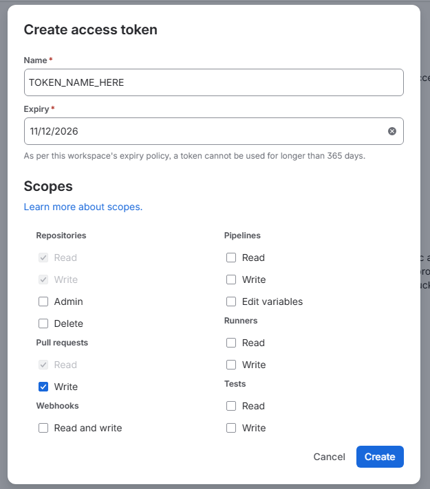

# Add a private Bitbucket repository

This takes one more private Bitbucket Cloud repository to a working preview on a docpreview that is already
running. If this is the first Bitbucket repository the daemon has ever seen, do the once-per-daemon part of
[Connect Bitbucket Cloud](./bitbucket.md) first, then come back here.

Do these in order. The order matters: the project has to exist before it can hold a token, and the token has to be
in place before the webhook is worth having, because a delivery that arrives first is acknowledged and dropped.

## Before you start

:::warning You need Bitbucket admin credentials

Steps 1 and 4 are done in the repository's settings, and only a repository **admin** can open them: creating an
access token and adding a webhook both need admin rights on the repository. Write access is not enough. Without
admin rights you will not see the **Repository settings** pages at all, so find someone who has them before you
start.

:::

| You need | Where it comes from |
|---|---|
| Admin credentials on the Bitbucket repository | A Bitbucket login with the repository's **Admin** permission. See above |
| The dashboard admin login | Whoever runs docpreview. See "Reaching the Projects page" below |
| The webhook URL | The daemon's webhook tunnel, e.g. `https://docpreview.shares.zrok.io/webhook/bitbucket` |
| The Bitbucket webhook secret | Already in the vault as `bitbucket.webhook_secret`. See Step 4 |
| The directory holding the site | The repository. The directory with the site's `package.json`, e.g. `docusaurus/` |

### Reaching the Projects page

As of November 2026, the public dashboard URL shows projects but will not create or edit one. Changing a project
is allowed only from the daemon's own machine, so reach it through an SSH tunnel:

```sh
ssh -N -L 18471:127.0.0.1:8471 <build-host>
```

and open `http://127.0.0.1:18471/projects`. The local port is 18471 so it cannot collide with a docpreview running
on your own machine.

If a viewer password is set, the tunnel still asks you to sign in. The console passwords are stored only as argon2
hashes, so docpreview cannot tell you one you have lost. Keep them in a password manager, and reset a lost one on
the build host (it reads the new password from the terminal, never from the command line):

```sh
ssh -t <build-host> "sudo -u docpreview /usr/local/bin/docpreview console password -role admin -config /etc/docpreview/config.yml"
```

Use `-role viewer` for the viewer password. Twelve characters minimum.

## Step 1: Create a repository access token

In the repository, open **Repository settings → Access tokens → Create Repository Access Token**.

As of November 2026 that page is at:

```text
https://bitbucket.org/<workspace>/<repo>/admin/access-tokens
```



- **Name:** `BB_REPO_TOKEN_PREVIEW_<REPO>`, with the repository's name in upper case and dashes turned into
  underscores. Bitbucket shows the token's name as the author of every preview comment, so it should say what the
  token is for and which repository it belongs to. A token cannot be renamed: a wrong name means creating a new
  token.
- **Expiry:** check it before you press **Create**. The field is filled in with a date that may be only a week
  away, and the workspace's policy may cap it (365 days for `netfoundry`). If you get it wrong, revoke
  the token and create another. When the token expires, previews for this repository stop: the clone fails and no
  comment is posted.
- **Scopes:** tick **Pull requests → Write** and nothing else. Bitbucket then ticks and greys out
  **Repositories → Read**, **Repositories → Write** and **Pull requests → Read** itself, because writing to a pull
  request needs them. So the token can push to the repository, which is one more reason to keep it scoped to a
  single repository.

Copy the token. Bitbucket shows it once.

### Leave yourself a note for the rotation

The token will expire, and by then nobody will remember how it was set up. Before you leave this page, write down
somewhere your team will find it (the team's runbook, a ticket, a calendar reminder a couple of weeks before the
expiry):

- the token's name, the repository, and the expiry date
- that it is stored as the credential of the docpreview project for `<workspace>/<repo>`, plus the name of any
  project environment variable that holds the same token (see Step 3)
- these rotation steps:
  1. Create a new token on the same page, with the same name and scope and a new expiry.
  2. In docpreview, open the project, paste the new token into its credential box, **Save**, then press
     **Test credential**. A rotation does not rebuild the open pull requests.
  3. Update any project environment variable that held the old token.
  4. Revoke the old token in Bitbucket.
  5. Update the note with the new expiry date.

## Step 2: Add the project

Through the tunnel, open **Projects → New project**.

| Field | Value |
|---|---|
| URL | `https://bitbucket.org/<workspace>/<repo>`, e.g. `https://bitbucket.org/netfoundry/frontdoor` |
| Directory | The directory holding the site's `package.json`, relative to the repository root, e.g. `docusaurus` |

Leave the other fields blank unless you know they are needed: a blank field defers to the framework preset, then
to the repository's own `.docpreview.yml`. Press **Create project**.

The new card then shows a red `Nothing queued: … no Bitbucket credential for <workspace>/<repo>`. That is
expected: creating a project tries to build its default branch straight away, and there is no token yet. Step 3
fixes it.

Check the **Directory** against the branch the project builds by default, which is the repository's default branch
and not always `main` (`develop`, for example). A directory with no `package.json` on that branch fails with
`no package.json in "<dir>"`.

:::note The directory decides which pull requests build

A pull request is built only when it changes something under the project's **Directory** (or `.docpreview.yml`).
One that touches only files elsewhere in the repository is skipped. Set the directory before the first pull request
arrives, not after.

:::

## Step 3: Give the project its token

Open the project. In its credential box, paste the token from Step 1 and **Save**, then press
**Test credential**. The test reads the repository and its pull requests and shows each step with its result. It
cannot check write access without writing something, so a missing **Pull requests → Write** scope shows up later,
as a build that succeeds with no comment.

Saving the project's first usable token scans its open pull requests and queues one build for each. The result is
shown under the Save. The project's default branch is built too.

If the site pulls content from **other private repositories** at build time, add each of their tokens to the
project's **Settings** (environment variables) under the name its build script reads, such as
`BB_REPO_TOKEN_CUSTOMER_CONNECT`. See [Projects](../reference/projects.md#environment-variables-scoped-to-a-project).

## Step 4: Add the webhook

In the repository, open **Repository settings → Webhooks → Add webhook**. As of November 2026 that page is at
`https://bitbucket.org/<workspace>/<repo>/admin/webhooks`.

| Field | Value |
|---|---|
| Title | `docpreview` |
| URL | The webhook URL, ending `/webhook/bitbucket` |
| Secret | The existing `bitbucket.webhook_secret` (see the warning below) |
| Status | Active |

Triggers: **Pull request → Created, Updated, Merged, Declined**. Add **Repository → Push** if the default branch's
preview should follow pushes.

:::danger Do not press Generate on a daemon that already serves Bitbucket repositories

The daemon has **one** Bitbucket webhook secret, and every repository's webhook must be signed with it. The
**Generate** button on the Settings page replaces it, and every webhook that was already set up with the old value
starts failing with `401` until each one is edited.

docpreview never shows a stored secret again. If nobody kept the current value, you can either:

- set up the webhook once at the **workspace** level (**Workspace settings → Webhooks**), which covers every
  repository in the workspace, or
- generate a new secret and update every existing Bitbucket webhook with it, all at once.

:::

## Step 5: Check it

1. **The project card** shows a default-branch preview and one row per open pull request that changes the
   directory.
2. **Push to a pull request.** Within a few seconds a build appears on the dashboard, and when it finishes the pull
   request has one comment from the token (`BB_REPO_TOKEN_PREVIEW_<REPO>`) with the preview link. Later pushes
   edit the same comment.
3. **The webhook's View requests tab** in Bitbucket shows each delivery and its response.

| What you see | What it means |
|---|---|
| `401` on the delivery | The webhook's secret is not the daemon's `bitbucket.webhook_secret` |
| `202` on the delivery, but nothing builds | No project for the repository, the pull request does not change the **Directory**, or it is from a fork |
| A build starts, then fails to clone | The token is missing, expired or revoked. Use **Test credential** |
| The build passes, but there is no comment | The token lacks **Pull requests → Write** |
| Nothing at all | The delivery never arrived. Check the URL, and that the webhook tunnel is up |

On the build host, the daemon's log names each decision:

```sh
journalctl -u docpreview -u docpreview-webhook -f
```
