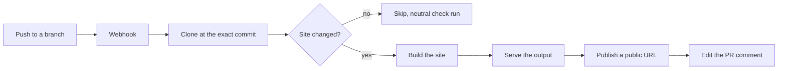

# NetFoundry Preview

You push a commit to a branch. A minute later a bot comment appears on the pull request with a link. You click it,
and there is your site, built from that branch and running at its own URL. Push again and the same comment updates
in place. Close the pull request and the preview goes away.

The site can be anything that builds to static files: a docs site, the Ziti admin console, a marketing page. If
Vercel already does this for you and you like it, keep using it. If you want the same loop on hardware you run,
here is another way. NetFoundry Preview is a single Go binary, `nfpreview`, that you can start on a laptop.
The public URL comes from [zrok](https://docs.zrok.io/) or
[NetFoundry Frontdoor](https://netfoundry.io/docs/frontdoor/intro/), or the preview stays private on an OpenZiti
overlay.

If you are reading this page in a preview, NetFoundry Preview built it from a pull request against its own
repository.

## Why you might want this

**Content you cannot send to a SaaS.** Unreleased docs, internal runbooks, a console that is not public yet. A
hosted preview service needs that content and a repository access token. Here the build runs on your hardware, and
the content leaves your network only through an ingress you control.

**Bitbucket, or Bitbucket *and* GitHub.** Preview tooling clusters around GitHub. If your site lives in Bitbucket,
or in both, you end up doing without or gluing two systems together.

**It should not be complicated.** A built site is a directory of static files. Serving one behind a URL is not a
distributed systems problem, and it should not need a control plane.

## What it actually does

One process, one sqlite file, no Kubernetes. Builds run in a throwaway Docker container by default. Running them
straight on the host is an opt-in.

## What it deliberately does not do

- **Production deployments.** This builds previews. Shipping the site is your existing pipeline's job. Mixing the
  two is how a preview URL ends up in a search index.
- **Fork pull requests.** Building a fork means running a stranger's `package.json` under your access token. The
  webhook refuses them before the payload is queued.
- **Anything but static sites.** If your site needs a server at request time, this is the wrong tool. See
  [Jamstack](./background/jamstack.md) for why that is a feature.

## This site is one of the repositories it builds

`www/` lives in the nfpreview repository, and NetFoundry Preview previews it on its own pull requests like any
other project. So the `baseUrl` check in [Troubleshooting](./troubleshooting.md) got strict for a reason, and a
broken link fails a real build instead of waiting months for someone to notice.

## Where to go next

- [Quickstart](./quickstart.md): running locally in about ten minutes, no account needed
- [Install on a Linux VM](./guides/linux-service.md): a cloud VM to a preview URL, as a systemd service
- [Architecture](./architecture.md): how the pieces fit and why they are shaped that way
- [GitHub App guide](./guides/github-app.md): the click-through you cannot avoid
- [age](./background/age.md): what the credential vault is, if that name is unfamiliar
